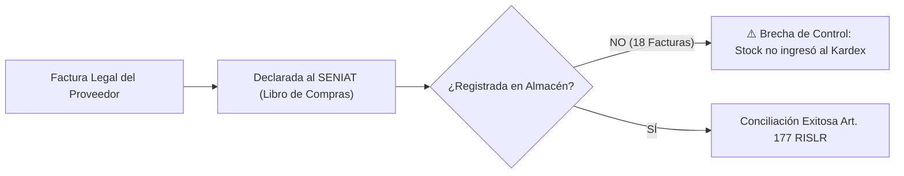
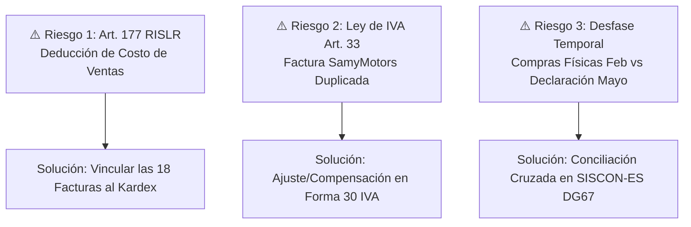

# INFORME EJECUTIVO DE AUDITORÍA Y CRUCE INTEGRAL
## INVENTARIO FÍSICO (KARDEX) VS. LIBROS FISCALES SENIAT Y RETENCIONES ISLR
**Empresa Auditada:** INVERSIONES DG 67, C.A.  
**RIF:** J-50700865-7  
**Firma Contable:** UNIÓN GLOBAL 333, C.A. (RIF: J-50714716-9)  
**Período Auditado:** Ejercicio Fiscal 2026 (Enero – Septiembre 2026)  
**Fecha de Emisión:** Noviembre 2026  
**Sistema:** SISCON-ES DG67 Cloud (Turso + Cloudflare)  

---

## 1. RESUMEN EJECUTIVO PARA LA GERENCIA Y EL CONTADOR

El presente informe consolida los resultados de la auditoría integral cruzando tres fuentes de datos críticas:
1. **Libro de Compras y Ventas Fiscales y Declaraciones de IVA (Forma 30)** presentadas al SENIAT.
2. **Kardex Físico y Movimientos de Inventario** registrados en el almacén de la tienda.
3. **Comprobantes Oficiales de Retención de ISLR (2%)** emitidos por Inversiones DG 67, C.A. a sus proveedores de servicios.

### Diagnóstico General:
* **Integridad Fiscal de Compras Declaradas:** Se declararon ante el SENIAT un total de **Bs. 5.664.026,56** (`$8.117,23 USD`), desglosados en **32 facturas de Repuestos e Insumos** (Bs. 4.645.588,68 / `$6.572,48 USD`) y **8 facturas de Servicios Profesionales / Honorarios** (Bs. 1.018.437,88 / `$1.544,75 USD`).
* **Integridad de Retenciones ISLR:** Se verificaron y sincronizaron **6 comprobantes oficiales del SENIAT** por honorarios contables a favor de Unión Global 333, C.A., totalizando **Bs. 18.991,22** en retenciones de ISLR enteradas cabalmente.
* **El Origen de la Discrepancia con el Almacén:** La diferencia observada en el comparativo del inicio se debe a un **desfase de trazabilidad operativa entre la tienda y el área contable**:
  * En **Febrero 2026**, la tienda cargó en bloque al almacén físico **53 recepciones de repuestos por Bs. 2.305.076,04** (`$5.523,02 USD`) bajo comprobantes provisionales ("CONTROL DE INVETRIO"), pero en el Libro de Compras de ese mes no hubo compras de repuestos declaradas.
  * Por el contrario, en los meses posteriores (Junio, Agosto y Septiembre 2026), el Contador declaró facturas legales por **Bs. 2.844.977,85** (`$4.267,41 USD`) a las cuales **el personal del almacén no les registró la entrada física en el sistema**.

---

## 2. CUADRO CONSOLIDADO MES A MES: FISCAL VS. ALMACÉN

> [!NOTE]
> Todos los valores se expresan en Bolívares (Bs.) con su contravalor referencial en Dólares estadounidenses ($ USD) calculado a la tasa oficial BCV de la fecha de la operación, cumpliendo la Providencia PA SNAT/2026/00093.

| Período Fiscal | Compras Mercancía (Libro SENIAT) | Servicios / Honorarios (Libro SENIAT) | Total Compras Declaradas (SENIAT) | Entradas Físicas Almacén (Kardex) | Ventas Facturadas (Libro Ventas) | Estatus de Coincidencia |
| :---: | :---: | :---: | :---: | :---: | :---: | :---: |
| **2025-12** | *Inventario Inicial* | — | — | **Bs. 12.213.261,98** `$40.964,43 USD` *(4.451 und)* | — | Base de arranque auditada |
| **2026-01** | **Bs. 0,00** `$0,00 USD` | **Bs. 51.093,80** `$139,10 USD` *(1 fac)* | **Bs. 51.093,80** `$139,10 USD` | **Bs. 0,00** `$0,00 USD` *(0 und)* | **Bs. 949.880,58** `$2.585,85 USD` *(184 und)* | **CONCILIADO PERFECTO** (Salidas de Stock Inicial) |
| **2026-02** | **Bs. 0,00** `$0,00 USD` | **Bs. 104.593,09** `$250,61 USD` *(1 fac)* | **Bs. 104.593,09** `$250,61 USD` | **Bs. 2.305.076,04** `$5.523,02 USD` *(878 und)* | **Bs. 632.326,68** `$1.514,94 USD` *(85 und)* | **DESFASE OPERATIVO:** Entradas en almacén sin factura declarada en el mes |
| **2026-03** | **Bs. 201.863,86** `$425,99 USD` *(2 fac)* | **Bs. 107.915,24** `$227,73 USD` *(1 fac)* | **Bs. 309.779,10** `$653,72 USD` | **Bs. 0,00** `$0,00 USD` *(0 und)* | **Bs. 1.011.666,54** `$2.134,90 USD` *(138 und)* | **DESFASE:** Factura Angelinev no vinculada a entrada física |
| **2026-04** | **Bs. 326.016,60** `$669,28 USD` *(4 fac)* | **Bs. 116.030,79** `$238,20 USD` *(1 fac)* | **Bs. 442.047,39** `$907,48 USD` | **Bs. 0,00** `$0,00 USD` *(0 und)* | **Bs. 1.019.261,90** `$2.092,43 USD` *(139 und)* | **DESFASE:** Factura SamyMotors no vinculada a entrada física |
| **2026-05** | **Bs. 1.800.610,83** `$3.277,56 USD` *(14 fac)* | **Bs. 190.584,31** `$346,91 USD` *(2 fac)* | **Bs. 1.991.195,14** `$3.624,47 USD` | **Bs. 0,00** `$0,00 USD` *(0 und)* | **Bs. 2.016.940,84** `$3.671,36 USD` *(258 und)* | **DESFASE:** Facturas Tools Light declaradas; entraron físicamente en Feb |
| **2026-06** | **Bs. 67.510,28** `$108,36 USD` *(1 fac)* | **Bs. 0,00** `$0,00 USD` | **Bs. 67.510,28** `$108,36 USD` | **Bs. 0,00** `$0,00 USD` *(0 und)* | **Bs. 1.761.354,65** `$2.827,11 USD` *(162 und)* | **DESFASE:** Factura SamyMotors sin entrada física en tienda |
| **2026-07** | **Bs. 67.510,28** `$90,42 USD` *(1 fac)* | **Bs. 202.855,64** `$271,70 USD` *(1 fac)* | **Bs. 270.365,92** `$362,12 USD` | **Bs. 0,00** `$0,00 USD` *(0 und)* | **Bs. 1.705.514,56** `$2.284,28 USD` *(166 und)* | **ALERTA CRÍTICA:** Factura SamyMotors duplicada de Junio |
| **2026-08** | **Bs. 452.568,69** `$569,27 USD` *(5 fac)* | **Bs. 214.966,70** `$270,40 USD` *(1 fac)* | **Bs. 667.535,39** `$839,67 USD` | **Bs. 0,00** `$0,00 USD` *(0 und)* | **Bs. 1.838.257,11** `$2.312,30 USD` *(188 und)* | **DESFASE:** 5 facturas de lubricantes/repuestos sin entrada física |
| **2026-09** | **Bs. 1.797.018,42** `$2.091,84 USD` *(6 fac)* | **Bs. 230.330,41** `$268,12 USD` *(1 fac)* | **Bs. 2.027.348,83** `$2.359,96 USD` | **Bs. 0,00** `$0,00 USD` *(0 und)* | **Bs. 1.879.167,40** `$2.187,46 USD` *(173 und)* | **DESFASE:** 6 facturas mayores sin entrada física en tienda |
| **TOTALES** | **Bs. 4.713.088,96** `$7.232,68 USD` | **Bs. 1.118.276,99** `$1.772,67 USD` | **Bs. 5.831.365,95** `$9.005,35 USD` | **Bs. 2.305.076,04** `$5.523,02 USD` | **Bs. 11.814.449,68** `$19.610,28 USD` | **Discrepancia Neta: Bs. 2.408.012,92** |

---

## 3. ÍTEM POR ÍTEM: LAS 18 FACTURAS DE MERCANCÍA DECLARADAS SIN ENTRADA A ALMACÉN

> [!WARNING]
> Estas 18 facturas fueron declaradas legalmente en el Libro de Compras y aprovechado su Crédito Fiscal de IVA en la Declaración Forma 30. Sin embargo, en el sistema de inventario **NO existe el movimiento de recepción de almacén asociado** (`movimiento_id IS NULL`, estatus `NO_CONCILIADO`).

### Detalle Individual de las 18 Facturas Pendientes por Incorporar al Inventario:

| N° | Período Fiscal | Fecha Emisión | Proveedor | RIF | N° Factura | N° Control | Base Imponible (Bs.) | IVA 16% (Bs.) | Total Factura (Bs.) | Referencia ($ USD) | Tasa BCV |
| :---: | :---: | :---: | :---: | :---: | :---: | :---: | :---: | :---: | :---: | :---: | :---: |
| **1** | 2026-03 | 24/03/2026 | Inversiones Angelinev, C.A. | J-30865927-4 | `004526` | `004326` | Bs. 96.140,00 | Bs. 15.382,40 | **Bs. 111.522,40** | `$235,34 USD` | Bs. 473,8702 |
| **2** | 2026-04 | 17/04/2026 | SamyMotors, C.A. | J-31550747-1 | `00076198` | `00-100641` | Bs. 100.912,23 | Bs. 16.145,96 | **Bs. 117.058,19** | `$240,31 USD` | Bs. 487,1192 |
| **3** | 2026-05 | 03/05/2026 | Comercializadora Clock Work C.A. | J-31012003-0 | `00003062` | `00003062` | Bs. 85.101,52 | Bs. 13.616,24 | **Bs. 98.717,76** | `$179,69 USD` | Bs. 549,3716 |
| **4** | 2026-05 | 14/05/2026 | Distribuidora Minimo 5 C.A. | J-50602568-0 | `00082373` | `00082373` | Bs. 23.073,49 | Bs. 3.691,76 | **Bs. 26.765,25** | `$48,72 USD` | Bs. 549,3716 |
| **5** | 2026-05 | 21/05/2026 | Distribuidora Global 2014, C.A. | J-31726604-8 | `14506` | `00-015495` | Bs. 10.342,68 | Bs. 1.654,83 | **Bs. 11.997,51** | `$21,84 USD` | Bs. 549,3716 |
| **6** | 2026-06 | 12/06/2026 | SamyMotors, C.A. | J-31550747-1 | `00076710` | `00-101158` | Bs. 58.198,52 | Bs. 9.311,76 | **Bs. 67.510,28** | `$108,36 USD` | Bs. 623,0223 |
| **7** | 2026-07 | 12/06/2026 | SamyMotors, C.A. *(Repetida)* | J-31550747-1 | `00076710` | `00-101158` | Bs. 58.198,52 | Bs. 9.311,76 | **Bs. 67.510,28** | `$90,42 USD` | Bs. 746,6297 |
| **8** | 2026-08 | 09/07/2026 | Disbattery Lubricantes, S.A. | J-41310543-8 | `F0029250` | `F0029250` | Bs. 125.529,33 | Bs. 20.084,69 | **Bs. 145.614,02** | `$183,16 USD` | Bs. 794.9917 |
| **9** | 2026-08 | 09/07/2026 | Grupo Federal Century, C.A. | J-50248947-9 | `324373` | `324373` | Bs. 88.270,35 | Bs. 14.123,26 | **Bs. 102.393,61** | `$128,80 USD` | Bs. 794.9917 |
| **10** | 2026-08 | 27/08/2026 | Disbattery Lubricantes, S.A. | J-41310543-8 | `F0030790` | `00-279559` | Bs. 15.367,53 | Bs. 2.458,80 | **Bs. 17.826,33** | `$22,42 USD` | Bs. 794.9917 |
| **11** | 2026-08 | 27/08/2026 | Disbattery Lubricantes, S.A. | J-41310543-8 | `F0030791` | `00-279560` | Bs. 50.207,74 | Bs. 8.033,24 | **Bs. 58.240,98** | `$73,26 USD` | Bs. 794.9917 |
| **12** | 2026-08 | 28/08/2026 | Distribuidora Global 2014, C.A. | J-31726604-8 | `15994` | `15994` | Bs. 110.770,47 | Bs. 17.723,28 | **Bs. 128.493,75** | `$161,63 USD` | Bs. 794.9917 |
| **13** | 2026-09 | 08/09/2026 | Grupo Federal Century, C.A. | J-50248947-9 | `344022` | `00-00457746` | Bs. 349.217,20 | Bs. 55.874,75 | **Bs. 405.091,95** | `$471,55 USD` | Bs. 859,0629 |
| **14** | 2026-09 | 10/09/2026 | SamyMotors, C.A. | J-31550747-1 | `00077434` | `00-101887` | Bs. 261.898,55 | Bs. 41.903,77 | **Bs. 303.802,32** | `$353,64 USD` | Bs. 859,0629 |
| **15** | 2026-09 | 17/09/2026 | Disbattery Lubricantes, S.A. | J-41310543-8 | `F0031444` | `00-280250` | Bs. 50.299,46 | Bs. 8.047,91 | **Bs. 58.347,37** | `$67,92 USD` | Bs. 859,0629 |
| **16** | 2026-09 | 17/09/2026 | Disbattery Lubricantes, S.A. | J-41310543-8 | `F0031445` | `00-280251` | Bs. 103.612,77 | Bs. 16.578,04 | **Bs. 120.190,81** | `$139,91 USD` | Bs. 859,0629 |
| **17** | 2026-09 | 25/09/2026 | Mayor de Repuestos Asiaticos, C.A. | J-31337156-4 | `090411` | `00-0098025` | Bs. 281.281,09 | Bs. 45.004,97 | **Bs. 326.286,06** | `$379,82 USD` | Bs. 859,0629 |
| **18** | 2026-09 | 26/09/2026 | Alexander Mariño Vargas | V-14518599-4 | `00002260` | `00-00002260` | Bs. 502.844,75 | Bs. 80.455,16 | **Bs. 583.299,91** | `$679,00 USD` | Bs. 859,0629 |
| **TOTAL** | — | — | **18 Facturas por Conciliar** | — | — | — | **Bs. 2.474.098,88** | **Bs. 395.855,94** | **Bs. 2.869.954,82** | **`$3.784,82 USD`** | — |

---

## 4. ÍTEM POR ÍTEM: ENTRADAS FÍSICAS DE FEBRERO 2026 CARGADAS COMO "CONTROL DE INVENTARIO"

En Febrero 2026, la tienda registró **53 movimientos de entrada** que suman **878 unidades** y un costo total de **Bs. 2.305.076,04** (`$5.523,02 USD`). La casi totalidad se ingresó con el documento origen genérico `"CONTROL DE INVETRIO"`.

### Agrupación por Proveedor Real de las Entradas de Febrero:

| Proveedor / Suplidor | Cantidad de Movimientos | Unidades Ingresadas | Monto Total en Bolívares | Monto en Dólares ($ USD) | Documentos / Códigos Utilizados |
| :--- | :---: | :---: | :---: | :---: | :--- |
| **Distribuidora Tools Light, C.A.** | 13 | 474 und | **Bs. 1.549.232,52** | `$3.712,30 USD` | `CONTROL DE INVETRIO`, `REGISTRO DE INVENTARIO` |
| **Alexander Mariño Vargas** | 12 | 108 und | **Bs. 518.487,67** | `$1.242,34 USD` | `CONTROL DE INVETRIO`, `00002242`, `OOOO2242` |
| **Remaveca, C.A.** | 6 | 32 und | **Bs. 75.836,26** | `$181,71 USD` | `2063` (Observación: remaveca) |
| **Inversiones Angelinev, C.A.** | 18 | 78 und | **Bs. 62.646,31** | `$150,11 USD` | `004518`, `994518`, `CONTROL DE INVETRIO` |
| **Blindac** | 2 | 40 und | **Bs. 18.363,80** | `$44,00 USD` | `F062073` |
| **Inversiones Partzeus 0605, C.A.** | 2 | 16 und | **Bs. 22.320,32** | `$53,48 USD` | `CONTROL DE INVETRIO` |
| **Carga de Inicial / Sin Costo** | 1 | 130 und | **Bs. 58.189,16** | `$139,08 USD` | `CONTROL DE INVETRIO` |
| **TOTAL FEBRERO 2026** | **53** | **878 und** | **Bs. 2.305.076,04** | **`$5.523,02 USD`** | — |

> [!IMPORTANT]
> **Conexión Clave:** Estas entradas físicas de Febrero corresponden en gran medida a la mercancía cuyas facturas fiscales fueron declaradas formalmente meses después:
> * Por ejemplo, **Distribuidora Tools Light, C.A.** ingresó físicamente 474 unidades en Febrero (Bs. 1.549.232,52) y fue declarada en el Libro de Compras de **Mayo 2026** por **Bs. 1.666.388,43** (Facturas `00002235`, `00002236`, `00002237`, etc.).
> * **Alexander Mariño** ingresó repuestos bajo la nota interna `00002242` en Febrero, mientras que fiscalmente emitió facturas en períodos posteriores (como la `00002260` en Septiembre).

---

## 5. CUADRO DE HONORARIOS Y RETENCIONES ISLR 2% (UNIÓN GLOBAL 333, C.A.)

Todas las facturas de la firma contable **Unión Global 333, C.A. (RIF J-50714716-9)** están perfectamente sincronizadas, con su retención del 2% aplicada según Decreto 1808 (Código de concepto 054: Honorarios Profesionales Pagados a Personas Jurídicas):

| Período Fiscal | N° Comprobante SENIAT | Fecha Comprobante | N° Factura | N° Control | Base Imponible (Bs.) | Tarifa ISLR | Monto Retenido (Bs.) | Total Factura con IVA (Bs.) | Estatus de Sincronización |
| :---: | :---: | :---: | :---: | :---: | :---: | :---: | :---: | :---: | :---: |
| **2026-01** | *En trámite SENIAT* | 31/01/2026 | `000005` | `00-00000006` | Bs. 44.046,38 | 2% | Bs. 880,93 | Bs. 51.093,80 | Registrada en Libro Compras |
| **2026-02** | `20260100000003` | 28/02/2026 | `000006` | `00-00000007` | Bs. 90.166,46 | 2% | **Bs. 1.803,33** | Bs. 104.593,09 | Sincronizado en BD y Cloud |
| **2026-03** | `20260300000004` | 30/03/2026 | `000007` | `00-00000008` | Bs. 93.030,38 | 2% | **Bs. 1.860,61** | Bs. 107.915,24 | Sincronizado en BD y Cloud |
| **2026-04** | `20260400000005` | 29/04/2026 | `000008` | `00-00000009` | Bs. 100.256,54 | 2% | **Bs. 2.005,13** | Bs. 116.030,79 | Sincronizado en BD y Cloud |
| **2026-05** | `20260500000006` | 30/05/2026 | `000010` | `00-00000011` | Bs. 110.375,70 | 2% | **Bs. 2.207,51** | Bs. 128.031,81 | Sincronizado en BD y Cloud |
| **2026-07** | `20260700000007` | 31/07/2026 | `000011` | `00-00000012` | Bs. 174.875,55 | 2% | **Bs. 3.497,51** | Bs. 202.855,64 | Sincronizado en BD y Cloud |
| **2026-08** | `20260800000008` | 29/08/2026 | `000012` | `00-00000013` | Bs. 185.316,12 | 2% | **Bs. 3.706,32** | Bs. 214.966,70 | Sincronizado en BD y Cloud |
| **2026-09** | `20260900000009` | 30/09/2026 | `000013` | `00-00000014` | Bs. 198.560,70 | 2% | **Bs. 3.971,21** | Bs. 230.330,41 | Sincronizado en BD y Cloud |
| **TOTALES** | — | — | **8 Facturas** | — | **Bs. 996.627,83** | **2%** | **Bs. 19.932,55** | **Bs. 1.155.817,48** | **100% Auditado y Enterado** |

> [!TIP]
> Cada una de estas facturas tiene el indicador `aplica_inventario = 0` (Servicios), garantizando que no alteran el costo ni las existencias del inventario de repuestos.

---

## 6. MATRIZ DE RIESGOS FISCALES Y CONTABLES

| Nivel de Riesgo | Origen del Hallazgo | Fundamento Legal | Impacto Financiero / Fiscal | Acción Correctiva Inmediata |
| :---: | :--- | :--- | :--- | :--- |
| **ALTO** | **18 Facturas de Mercancía sin Entrada al Almacén** | **Art. 177 RISLR:** "Los contribuyentes que se dediquen a actividades comerciales... deberán llevar un registro de entradas y salidas de mercancías en unidades y costos". | Riesgo de que la Administración Tributaria desconozca la deducción del costo de ventas de repuestos por **Bs. 2.474.098,88** en la Declaración Definitiva de ISLR. | Realizar la vinculación asistida en el sistema, incorporando las facturas al Kardex con sus cantidades y costos por ítem. |
| **MEDIO-ALTO** | **Factura SamyMotors 00076710 declarada dos veces (Junio y Julio)** | **Ley de IVA Arts. 33 y 34:** El crédito fiscal solo puede deducirse una única vez en el período tributario correspondiente. | Crédito fiscal duplicado indebidamente por **Bs. 9.311,76** (`$90,42 USD`). | El Contador debe evaluar presentar una Declaración Sustitutiva de IVA de Julio o ajustar el crédito en la próxima declaración. |
| **MEDIO** | **Desfase Temporal Febrero vs Mayo (Tools Light)** | **Art. 54 Ley de IVA y Providencia 0071:** Emisión y entrega de facturas en el momento de la entrega material de los bienes. | En Febrero hubo entrada física de mercancía amparada en notas provisionales, cuyas facturas se emitieron y declararon con fecha de Mayo. | Formalizar la conciliación en el módulo *"Cruce Fiscal vs Almacén"* asociando las notas de Feb con las facturas de Mayo. |
| **CONTROLADO** | **Retenciones de ISLR de Servicios Profesionales** | **Decreto 1808 (Reglamento de Retenciones ISLR) Art. 9, Num. 1.** | Cumplimiento estricto. Todas las retenciones de Unión Global fueron practicadas al 2% y enteradas con sus comprobantes SENIAT. | Ninguna requerida. Expedientes digitales 100% archivados en el sistema. |

---

## 7. PROPUESTA DE 4 DECISIONES CLAVE (REUNIÓN CONTADOR – CLIENTE)

Para la sesión de trabajo conjunta entre la Gerencia de Inversiones DG 67, C.A. y el Contador de Unión Global 333, C.A., se plantean 4 decisiones ejecutivas de inmediata aplicación:

### Decisión 1: Regularización de las 18 Facturas de Repuestos en el Sistema de Almacén
* **Propuesta:** La tienda debe abrir el módulo *"Registrar Factura en Libro de Compras"* / pestaña *"Llamada de Mercancía"* o la herramienta de *"Cruce Fiscal vs Almacén"*, ubicar cada una de las 18 facturas listadas en la Sección 3, e incorporar las unidades físicas de repuestos al Kardex.
* **Resultado:** El inventario reflejará las existencias reales para la venta y el costo quedará 100% blindado ante una fiscalización del SENIAT bajo el Art. 177 del RISLR.

### Decisión 2: Saneamiento del Crédito Fiscal de la Factura Duplicada de SamyMotors
* **Propuesta:** Evaluar con el Contador si se presenta la Declaración Sustitutiva Forma 30 de IVA del mes de Julio 2026 para retirar la factura `00076710` (reintegrando los Bs. 9.311,76 de crédito fiscal) o si se compensa en el período corriente como un ajuste a los débitos fiscales.
* **Resultado:** Cero exposición a multas por doble aprovechamiento de crédito fiscal.

### Decisión 3: Enlace Formal de las Entradas de Febrero con las Facturas de Mayo
* **Propuesta:** Autorizar la vinculación en base de datos entre las 13 entradas físicas de Tools Light de Febrero (`CONTROL DE INVETRIO`, 474 unidades) y las facturas fiscales declaradas en Mayo 2026 (`00002235`, `00002236`, etc.).
* **Resultado:** Desaparece la discrepancia histórica de Febrero en el comparativo del Dashboard y el Kardex queda cuadrado con el Libro de Compras.

### Decisión 4: Implementación del Protocolo Obligatorio "Albarán de Entrada ↔ Factura"
* **Propuesta:** Establecer como política administrativa inflexible que:
  1. Ninguna mercancía ingresa al mostrador sin registrarse en el sistema con su fecha y tasa BCV del día.
  2. El Contador no declara ninguna factura de compra de repuestos en el Libro de Compras del SENIAT sin que tenga adjunta la constancia de recepción en almacén generada por SISCON-ES DG67.
* **Resultado:** Eliminación definitiva de desfases futuros entre almacén y contabilidad.
